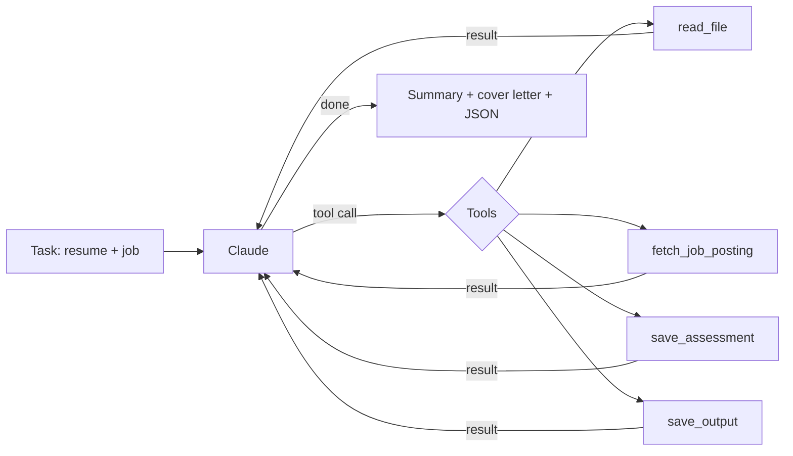

# Job Application Agent

An agentic AI assistant that reads your resume and a job posting, scores your fit, flags skill gaps, and drafts a tailored cover letter, without inventing experience you don't have.

Built from scratch with the Anthropic API and tool calling. No agent framework, so the agent loop is fully visible.

## How it works



The model decides which tools to call and in what order. The code only runs the tools and returns results until the model stops requesting them.

## Features

- Accepts a job posting as a **URL or a local file**. The agent picks the right tool.
- Reads resumes in **.pdf or .txt** format
- Saves a **structured JSON assessment** (score, matched skills, gaps, summary)
- Writes a tailored **cover letter** grounded only in the resume
- Tracks **steps, tokens, and latency** per run
- Includes an **eval suite** with known-answer test cases

## Quickstart

```bash
git clone https://github.com/YOUR-USERNAME/job-app-agent.git
cd job-app-agent
python -m venv .venv
.venv\Scripts\activate        # Mac/Linux: source .venv/bin/activate
pip install -r requirements.txt
cp .env.example .env          # then add your Anthropic API key
```

## Usage

```bash
python main.py --resume examples/resume_sample.txt --job examples/job_strong.txt
python main.py --resume my_resume.pdf --job https://example.com/job-posting
python main.py --job examples/job_partial.txt --model claude-sonnet-5-5
```

Outputs are saved to `outputs/`.

## Evaluation

Three test cases with known expected outcomes check the score range, that skills present on the resume are matched, and that missing skills are flagged.

```bash
python -m evals.run_evals
python -m evals.run_evals claude-sonnet-5-5
```

| Case | Haiku 5.5 | Sonnet 5.5 | Expected | Result |
|---|---|---|---|---|
| Strong match | 88 | 95 | 70–100 | ✅ both |
| Partial match | 28 | 35 | 20–60 | ✅ both |
| Weak match | 5 | 8 | 0–20 | ✅ both |
| **Avg tokens/run** | ~12.1K | ~8.7K | | |
| **Avg steps/run** | 3.7 | 3.0 | | |

**Finding:** Sonnet used about 30% fewer tokens per task than Haiku, because it called tools in parallel and finished in fewer steps. In agent loops, every extra step re-sends the conversation history, so step count drives cost as much as model size does.

## Design decisions

- **No framework.** The agent loop is about 40 lines, which makes control flow, error handling, and costs easy to inspect.
- **Tools return errors as text** instead of raising exceptions, so the agent can read a failure and recover.
- **Structured output through a tool.** The assessment is a tool call with a JSON schema, which makes results machine-checkable for evals.
- **Grounding rule.** The system prompt forbids inventing skills. In testing, the agent correctly declined to claim TensorFlow, OpenCV, or degree requirements missing from the resume.
- **Safety.** A step limit prevents runaway loops, and file writes are restricted to `outputs/`.

## Project structure

```
job-app-agent/
├── job_agent/
│   ├── agent.py      # agent loop, system prompt, tool schemas
│   └── tools.py      # tool implementations
├── evals/
│   ├── cases.json    # test cases with expected outcomes
│   └── run_evals.py  # eval runner
├── examples/         # sample resume and job postings
├── main.py           # CLI entry point
└── requirements.txt
```

## Roadmap

- Larger eval set, plus LLM-as-judge scoring of cover letter quality
- Batch mode to rank many job postings against one resume
- Simple web UI (Streamlit)

## Author

Dilawar Javaid